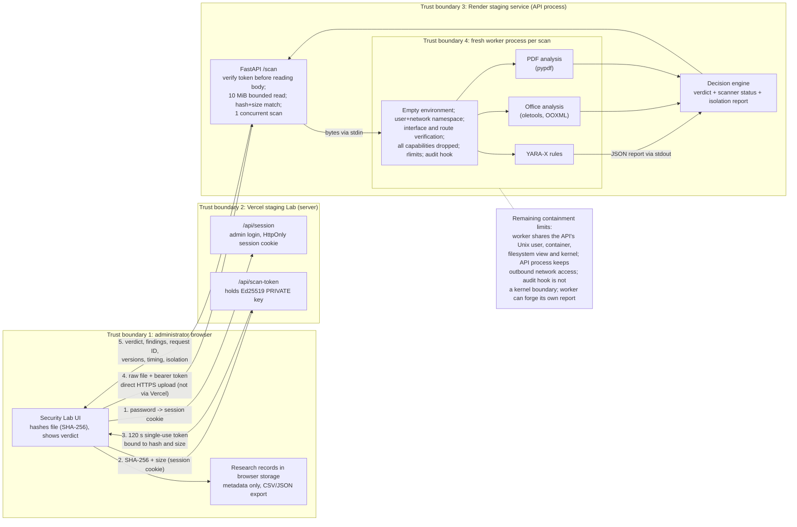

# FilesMagic Security Engine: capstone evidence package

**NIU CSCI 499 Honors Capstone · Almuthanna Shihab**
**Supervisor:** Dr. Nur Imtiazul Haque
**Evidence cut-off:** 2026-10-26 (America/Chicago)
**Research status:** implementation and benign/inert-synthetic staging validation complete;
independently labelled real-world evaluation **not conducted**; genuine-malware work **blocked**
pending approvals (Section 18).

How to read this document: every result names its source (CI run, deployment ID, request ID or
repository file). Section 2 separates what was **demonstrated** from **design assumptions** and
**planned work**. Counts from different runs are kept separate and are never added together.

## Abstract

FilesMagic converts user-supplied documents. This project builds a file-aware security gate
designed to inspect an upload before a conversion service processes it. The hardened engine is
deployed only as a **separate research staging service**. This package has no verified evidence
that the customer-facing FilesMagic conversion pipeline calls it. A FastAPI engine combines
YARA-X signatures with structural analysis of Microsoft Office and PDF files, and returns an
explainable verdict (`SAFE`, `SUSPICIOUS`, `MALICIOUS` or `UNABLE_TO_SCAN`). The engine and an
authenticated research interface (the Security Lab) run as a separate staging deployment.

How a scan works:

1. The Lab issues a short-lived token bound to one file's hash and size.
2. The browser uploads the file directly to the engine, which runs every scan in a fresh worker
   process.
3. On Linux the worker enters its own user and network namespace and verifies that no usable
   outbound route exists. It then drops all Linux capabilities and runs under resource limits.
4. Strict mode refuses to analyse a file unless every required control is confirmed.

On the hosted staging service the first strict-mode deployment refused every scan. The cause
was a kernel-created tunnel interface (`tunl0`) that the original loopback-only check did not
anticipate. The project diagnosed it and narrowed the policy to that one verified-inert device.
It then exercised the corrected controls in Linux CI, including with a real `tunl0`. On Render,
it observed them only as values the worker reports from its own kernel read-backs.

Linux CI and benign staging tests show that these mechanisms work in their tested environments.
The 16 inert synthetic fixtures exercise the intended rules and error paths. They do **not**
measure detection accuracy on genuine malware.

## 1. Research problem and motivation

Converting documents means parsing files supplied by strangers. A hostile document can carry
active PDF actions, Office macros or remote relationships, or structure designed to crash a
parser. A conversion pipeline therefore benefits from a gate that does three things:

- recognises known risky indicators;
- explains what it found;
- declines to pass on files it could not analyse.

The engine is a static, explainable gate. It is not an antivirus certification and not a
complete sandbox. A `SAFE` verdict means every applicable scanner completed without a finding
above `INFO`; it does not prove a file is harmless
([decision rules](../app/decision/__init__.py)).

The research setting adds a second problem. To evaluate the gate against real malicious
documents later, untrusted parsing must be contained well enough, and governed well enough,
that such an evaluation is permissible at all. Much of the engineering here therefore concerns
**containment and honest reporting of containment**, not only detection.

## 2. Objectives, research questions and evidence status

**Objectives**

1. Detect and explain selected document indicators with complementary signature and structural
   scanners.
2. Keep untrusted parsing out of the API process, and fail closed whenever analysis or a
   required isolation control fails.
3. Determine whether the gate can run, with verified isolation, on a separate low-cost staging
   service.
4. Design a later evaluation, against independently labelled samples, of detection, false
   positives, coverage and cost.

**Research questions (open)**

- How often does the gate flag independently confirmed malicious documents?
- How often does it flag legitimate documents that use active features?
- How often is it unable to decide?
- How do results vary by format, feature, malware family and sample age?
- What latency and memory does per-scan process isolation cost?

No current result answers these population-level questions.

| Claim | Status | Basis |
|---|---|---|
| Scanners, decision rules, token workflow and fail-closed handling behave as specified | **Demonstrated** | CI test suites; Phase C4 acceptance checks |
| Worker namespace blocks outbound connections; capabilities cannot be regained after the drop | **Demonstrated in Linux CI** (kernel behaviour on the GitHub runner) | `tests/test_worker_linux.py`, runs below |
| Same controls are in place on Render | **Runtime-reported** by the worker on Render, not independently probed there | Scan results and logs (Section 13) |
| 16 synthetic fixtures produce their intended verdicts | **Demonstrated** (functional behaviour only) | Phase C4 A8 |
| Detection rate, false-positive rate or false-negative rate on real documents | **Not measured** | No labelled dataset scanned |
| The engine is suitable for hosted live-malware analysis | **Not established**; blocked | Sections 16-18 |
| The gate protects the customer-facing conversion pipeline | **Not claimed**; integration not verified | Section 14 |
| Offline evaluation design (ground truth, metrics, VM procedure) | **Planned** | [evaluation/README.md](../evaluation/README.md), [sample-handling proposal](malware-sample-handling-procedure.md) |

## 3. Security architecture

**Trust boundaries in words.**

- **Browser.** Trusted only as an authenticated administrator. Research records stay in that
  browser.
- **Vercel Lab.** Holds the only signing key and the admin credentials.
- **Render API.** Holds only the public key. It never parses a document itself: it only hashes
  the file and reads magic bytes.
- **Worker.** The least trusted component. It runs the parsers on attacker-controlled bytes.
  Its report is validated for shape and scanner set; its contents are trusted.

The file never passes through Vercel. Code: [token issuer](../frontend/lib/auth.ts),
[browser client](../frontend/lib/api.ts), [engine authorization](../app/auth.py),
[API](../app/main.py), [worker](../app/worker.py).

## 4. Detection methods

| Layer | Implemented role | Known limits |
|---|---|---|
| YARA-X ([rules](../app/rules/filesmagic.yar), [scanner](../app/scanners/yarax.py)) | Matches curated rules against raw bytes; named, severity-graded findings | Compressed or obfuscated content can evade raw-byte patterns; only known indicators |
| Office ([scanner](../app/scanners/office.py)) | oletools plus bounded OOXML ZIP/XML inspection: macros, auto-execution, embedded objects, external relationships, DDE, encryption, package abuse | Embedded documents are not scanned recursively; some legacy and obfuscated constructs are blind spots |
| PDF ([scanner](../app/scanners/pdf.py)) | pypdf plus bounded object traversal: JavaScript, automatic and Launch actions, attachments, links, forms, encryption | No script execution or deobfuscation; attachments are not scanned recursively |

Scanners identify formats from content, never from filenames.

## 5. Authenticated scan-token workflow

1. The administrator logs in to the Lab. The session cookie is `HttpOnly` and
   `SameSite=Strict`, and `Secure` in production builds, including the staging deployment
   ([cookie settings](../frontend/lib/auth.ts)).
2. The browser computes the file's SHA-256 and size. The Lab's server route checks the session
   and signs an Ed25519 token with these claims:
   - audience `filesmagic-security-engine/scan`;
   - issue time, and expiry 120 s later;
   - a single-use identifier;
   - the hash and the size.

   Files over 10 MiB are refused before a token is issued
   ([route](../frontend/app/api/scan-token/route.ts)).
3. The engine verifies the token **before reading the body**, then:
   - reads at most 10 MiB within 60 s;
   - rejects a hash or size mismatch (403) and a reused token;
   - allows one concurrent scan in staging (429 otherwise);
   - throttles failed authentication per address
   ([auth](../app/auth.py), [API](../app/main.py)).
4. Replay and throttle state is held in memory and resets on restart (a documented limitation).

## 6. Fail-closed handling

| Condition | Outcome |
|---|---|
| Worker timeout (30 s), crash, native fault, output over 1 MB, invalid report or unexpected scanner set | Every scanner `failed` with kind `worker`; verdict `UNABLE_TO_SCAN` |
| Scanner raises on malformed or hostile input | That scanner `failed` (`malformed_input` / `invalid_structure` / `unexpected`). The verdict is `MALICIOUS` if any other scanner found HIGH/CRITICAL, `SUSPICIOUS` if any found LOW/MEDIUM, otherwise `UNABLE_TO_SCAN`. In every case `complete=false` |
| Strict mode and any required isolation control not literally `true` | Worker refuses to read the document; `UNABLE_TO_SCAN`; `isolation_missing` names the controls |
| No applicable scanner | `UNABLE_TO_SCAN`, explicitly "NOT security-scanned" |

**Gate rule for any integration.** Findings outrank failures, so a `SUSPICIOUS` or `MALICIOUS`
verdict can come from an **incomplete** analysis in which another scanner failed. `SAFE` is
returned only when no applicable scanner failed. Incomplete analysis must never automatically
authorize conversion, whatever the verdict. Only `SAFE` with `complete=true` (and, in strict
mode, `isolation_missing=[]`) should pass. Everything else blocks or is held for review.

Logs carry only a request ID, a hash prefix, the size, scanner names, failure kinds and the
verdict. They never carry filenames, file contents or exception text, which can be
attacker-controlled. The C7A staging failure (Section 10) is real evidence of this behaviour:
a missing control produced `UNABLE_TO_SCAN`, never `SAFE`.

## 7. Worker process isolation

Every scan starts a new `python -m app.worker` process:

- an empty environment, so it inherits no secrets;
- bounded output and a wall-clock timeout;
- its own process group, killed afterwards.

Before reading the document the worker applies these controls in order
([worker](../app/worker.py)):

1. **User and network namespace.** It calls `unshare(CLONE_NEWUSER|CLONE_NEWNET)`, then verifies
   the network (Section 8).
2. **Capability drop.** All capabilities are dropped (Section 11).
3. **Resource limits.** Kernel rlimits on CPU time (20 s), writable memory (256 MB in staging)
   and file size (0, so no writes), plus 32 open files, no new processes or threads, and no
   core dumps.
4. **Python audit hook.** It refuses sockets, process creation, native library loading and
   writes. This is an in-process guard against Python code paths, **not** an operating-system
   boundary.

Strict mode (`SECURITY_ENGINE_REQUIRE_ISOLATION=1`, enabled on staging) requires every value in
`worker.REQUIRED_CONTROLS`:

- `process`, `network_namespace`, `network_verified`, `net_interfaces_safe`;
- the four route checks;
- `capabilities_dropped`, `rlimits`, `audit_hook`.

## 8. Network namespace verification

Inside its namespace the worker checks, through OS interfaces only (no DNS, no packets sent):

- **Interfaces:** the interface list (`if_nameindex`), cross-checked against `/proc/net/dev`,
  plus each interface's flags, link type and IPv4 address via `SIOCGIF*` ioctls. These describe
  the calling process's namespace; `/sys` does not, so it is not used.
- **Routes:** `/proc/net/route` and `/proc/net/ipv6_route` must hold no usable non-loopback
  route (`net_ipv4_no_route`, `net_ipv6_no_route`).
- **Route lookups:** UDP `connect()` to the documentation addresses `192.0.2.1` and
  `2001:db8::1` must fail as unreachable (`net_ipv4_unreachable`, `net_ipv6_unreachable`). A UDP
  connect only selects a route; it sends nothing.

`network_verified` is true only if `net_interfaces_safe` and all four route checks hold. Any
error leaves the affected checks false.

## 9. Scanner verdict interpretation

The decision rules, applied in order ([decision](../app/decision/__init__.py)):

1. Any `HIGH` or `CRITICAL` finding → `MALICIOUS`.
2. Any `LOW` or `MEDIUM` finding → `SUSPICIOUS`.
3. No scanner ran, or any scanner failed → `UNABLE_TO_SCAN`.
4. Otherwise → `SAFE`.

Findings outrank failures: any LOW-to-CRITICAL finding yields `SUSPICIOUS` or `MALICIOUS` even
if another scanner failed. Such results carry `complete=false` and are partial analyses
(Section 6).

Interpretation for a conversion gate:

- `SAFE` means "no known indicator found by completed scanners", not "harmless".
- `SUSPICIOUS` includes legitimate documents with active features, such as forms, attachments
  or external templates.
- `MALICIOUS` is the engine's severity judgement about an indicator, not a confirmed label.
- `UNABLE_TO_SCAN` must never be treated as `SAFE`, and no verdict with `complete=false`
  should authorize conversion.

## 10. The Render `tunl0` discovery and correction (Phases C7A-C7D)

| Phase | Commit / deployment | What happened | Evidence |
|---|---|---|---|
| C7A | `a9b7231` | Strict mode refused every benign scan: `net_loopback_only=false`, so `network_verified=false`; all four route checks, the namespace, rlimits and audit hook were true. Fail-closed worked as designed; nothing was relaxed. | Requests `afe07dd2598f4b21`, `fb82e7f9087d4b3f` |
| C7B | `1f92c7a`, `dep-dbfp4p29lscs73elsk20` | Staging-only diagnostics, written to the server log and never returned in responses, showed `lo` and `tunl0` (index 2, link type 768 = IP-in-IP). `tunl0` was down, not running, with no IPv4/IPv6 address and no usable routes. The first deploy attempt (`dep-dbfoajei0phs73d8qat0`) failed on a Render health-check timeout; the identical image then deployed normally. | Request `077dfe79e6c84e41`; [readiness §13](malware-research-readiness.md#13-render-network-interface-finding-and-correction-phases-c7a-c7c) |
| C7C | `3b35ee9`, `0a91480` | Policy narrowed to "lo only" or "lo + verified-inert `tunl0`"; capability drop added; CI reproduces `tunl0` with the real kernel module. The first CI run ([40375739776](https://github.com/almuthanna1/filesmagic-security-engine/actions/runs/40375739776)) failed one new test whose expected errno was wrong (`setuid` returns `EINVAL` in an unmapped user namespace, not `EPERM`); `0a91480` corrected the expectation. | [CI 40375905364](https://github.com/almuthanna1/filesmagic-security-engine/actions/runs/40375905364) |
| C7D | `0a91480`, `dep-dbfplih42hec738cakpg` | On Render: `net_loopback_only=false`, `net_fallback_tunnel_inert=true`, `net_interfaces_safe=true`, `network_verified=true`, `capabilities_dropped=true`, `isolation_missing=[]`; harmless files `SAFE`. | Section 13 |

**Why the original check was too strict.** Comparing interface *names* with `{lo}` is sufficient
for "no usable outbound path", but not necessary. The kernel creates the `tunl0` fallback device
in every new network namespace while the host has the `ipip` module loaded, and it cannot be
deleted from inside. The goal is unchanged; the check now verifies the extra device's state
instead of rejecting it by name. The GitHub runner does not load `ipip`, which is why CI had
never seen it.

**Accepted policy.** `net_interfaces_safe` is true for exactly one of two states:

- only `lo`; or
- exactly `lo` and `tunl0`, where every one of these holds:
  - `/proc/net/dev` agrees with the interface list;
  - `lo` has the loopback flag and link type 772;
  - `tunl0` has link type 768, is down, not running and not a loopback device;
  - `tunl0` has no IPv4 address;
  - `tunl0` has no IPv6 entry, and every line of `/proc/net/if_inet6` is well formed;
  - no usable IPv4 or IPv6 route uses `tunl0`.

Everything else fails:

- any other or additional interface, or another tunnel name or type;
- an up or running tunnel;
- any address or route;
- a missing, non-boolean or contradictory value;
- any query error.

Both states reported at once also fails. The report stays literal: on Render
`net_loopback_only` is honestly `false`.

## 11. Linux capability restrictions

In its own user namespace the worker initially holds every capability, including
`CAP_NET_ADMIN` over its network namespace. Native code could otherwise bring `tunl0` up or add
routes after verification. Immediately after verification, while single-threaded, the worker:

1. sets `PR_SET_NO_NEW_PRIVS`;
2. sets and locks `SECBIT_NOROOT`, `SECBIT_NO_SETUID_FIXUP` and `SECBIT_NO_CAP_AMBIENT_RAISE`,
   and locks `SECBIT_KEEP_CAPS` off;
3. drops the whole bounding set;
4. clears the ambient set;
5. empties the effective, permitted and inheritable sets with `capset()`.

`capabilities_dropped` is true only if `/proc/self/status` then shows all five capability sets
as zero, `NoNewPrivs: 1` and one thread, and `PR_GET_SECUREBITS` shows the locks. The API
process's privileges are unchanged, and no host privilege is added. This is **not** a container
or VM boundary.

**Proven in Linux CI** (`test_capabilities_are_dropped_in_the_kernel_and_cannot_be_regained`, in
a throwaway namespace on the runner):

- Before the drop, `lo` could be reconfigured, so the capability was real.
- After the drop:
  - `SIOCSIFFLAGS` fails with `EPERM`;
  - re-raising `CAP_NET_ADMIN` via `capset()` fails with `EPERM`, as do an ambient raise and
    unlocking the securebits;
  - `setuid(0)` fails with `EINVAL`;
  - the bounding set lacks `CAP_NET_ADMIN`;
  - an executed child process has no capabilities and keeps `NoNewPrivs`;
  - after creating a nested user namespace, reconfiguring the worker's namespace still fails
    with `EPERM`.

**On Render** only the worker's own `capabilities_dropped=true` is observed. That value is a
kernel read-back performed by the worker, not an independent probe.

## 12. Synthetic fixture methodology

The Lab's [test catalog](../frontend/lib/testCatalog.ts) defines 16 inert fixtures, generated
deterministically in the browser:

- 6 benign controls: text, CSV, RTF, OOXML, SVG and PDF;
- 6 suspicious-indicator fixtures:
  - an SVG with an empty `<script>` element;
  - an SVG with an empty `onload` event handler;
  - an RTF DDE marker;
  - an OOXML external template;
  - a PDF with an embedded text attachment;
  - a PDF with automatic JavaScript containing an empty script;
- 3 high-severity-indicator fixtures (OOXML `ms-` external relationship, RTF auto-updating object
  marker, PDF `/Launch` action with no target);
- 1 deliberately malformed PDF.

None contains executable payloads, exploit code or real malware.

Their expected verdicts were chosen from the engine's own rules. They therefore test that the
implementation does what it is designed to do. They are **not** independent ground truth. A
16/16 match is not a true-positive rate, false-positive rate, precision, recall or evidence about
arbitrary malicious documents. The `MALICIOUS` label on an inert fixture is the engine's verdict
about an indicator, not a confirmed classification.

## 13. Test results and evidence register

The runs below are **separate**. The 27 tests of the `tunl0` rerun are a subset of the Linux
module that is also part of the 368. CI reruns of the same commit range are not new tests.

| Evidence | Version and environment | Result |
|---|---|---|
| [CI 40375905364](https://github.com/almuthanna1/filesmagic-security-engine/actions/runs/40375905364) | Backend `0a9148026d5d552d120ab76ba3d1d19d20f14049`; Ubuntu 24.04, Python 3.11, non-root; `FM_REQUIRE_LINUX_TESTS=1` (Linux tests may not skip) | Backend job: **368 passed**, 0 failed, 0 skipped. Second step with `ipip` loaded (real `tunl0` in every new namespace): `tests/test_worker_linux.py` **27 passed**, 0 skipped. Production-image and frontend jobs passed. |
| [CI 40381320558](https://github.com/almuthanna1/filesmagic-security-engine/actions/runs/40381320558) | Frontend commit `279ad39428d3ac557003ae70b52791cb240f1b0d` | All three jobs passed; again **368 passed** and **27 passed** (same suites, new run, not 395 new tests). |
| [Phase C4 record](phase-c4-test-results.md) | Engine and Lab at `90453e4`, benign/synthetic staging | **19/19** acceptance checks passed; **16/16** fixtures matched; an extra on-Render egress demonstration (N1) was **blocked** (no shell on Render Free; shown in CI instead). Historical, not retested in C7. |
| C7D hosted scans (this phase series) | Render `0a91480`, `dep-dbfplih42hec738cakpg`; staging Lab then still the earlier frontend (`…a2xoc1lgx`) | Harmless DOCX `SAFE` (`d725d991ca8944c1`, 6,808 ms); harmless PDF `SAFE` (`9da181d003954729`, 6,453 ms); inert synthetic Launch-indicator PDF `MALICIOUS` with `PDF_Launch_Action` + `PDF_LAUNCH_ACTION` (`406c1cb8b72e4797`, 6,201 ms). All three: every isolation value as listed in Section 10, `isolation_required=true`, `isolation_missing=[]`; the server log showed `lo` + inert `tunl0` for each request. Unauthenticated scans returned 401, CORS admitted only the staging Lab, and the response carried no diagnostics. |
| C7E hosted scans (recorded in Phase C7E) | Render `0a91480`; Vercel staging `279ad39`, `dpl_4RLCd1apcJmGAsCY4Pwq6Bqr7WQ8` | Harmless DOCX `SAFE` (`c0d5fa59d3194922`, 7,111.4 ms); harmless PDF `SAFE` (`e6bbdbfdf4594524`, 6,341.9 ms); inert synthetic Launch-indicator PDF `MALICIOUS` (`5edb0d4ba37d4b3c`, 6,432.9 ms); no missing required control. Admin login succeeded; unauthenticated token and scan requests returned 401; CSV/JSON exports kept findings and isolation metadata; an 11 MiB file showed the 10 MB limit message before upload. Checked against Render logs during C7E; not re-executed for this package. |

**Deployment identity (rechecked for this package, read-only):**

- Vercel deployment `dpl_4RLCd1apcJmGAsCY4Pwq6Bqr7WQ8` is Ready and aliased to
  <https://filesmagic-security-lab-staging.vercel.app>.
- Render staging runs `0a91480` (`dep-dbfplih42hec738cakpg`).
- No infrastructure was changed in Phase C8.

**Evidence types.** CI results are kernel evidence from the GitHub runner. Render isolation
values are **runtime-reported by the worker being assessed**. Browser exports downloaded in C7E
are local working files, not repository artifacts; keep reviewed copies if they are needed for
submission.

## 14. Deployed staging results

- **Engine.** Render workspace "FilesMagic Research", service `srv-dbelc2jrjlhs7382nv5g`, on the
  Free plan with Auto-Deploy off.
  - Configuration: strict isolation on, one concurrent scan, 256 MB worker memory, 30 s timeout.
  - CORS admits the staging Lab origin only.
  - Diagnostics (`SECURITY_ENGINE_NET_DIAGNOSTICS=1`) are still enabled and go to the server log
    only.
- **Lab.** Vercel project `filesmagic-security-lab-staging`, deployed without a Git connection.
  It shows a dedicated isolation report that explains `net_loopback_only=false` when the inert
  tunnel was verified ([IsolationReport](../frontend/components/IsolationReport.tsx)).
- **Production.** The customer-facing FilesMagic site and conversion backend, the original
  Security Engine, and `main` (`e6fdbd4`) were not changed by this work.
- **Integration status.** The hardened engine exists on the research branch and the staging
  service only. Whether, or how, the customer-facing conversion pipeline calls any version of the
  engine was not examined or verified for this package. Integrating the gate, with the rule in
  Section 6, is future work, and nothing here claims it is in place.

## 15. System performance

| Measurement | Value | Scope |
|---|---|---|
| Phase C4, 16 fixtures, warm Free instance | min 5,666 ms, median 6,457 ms, max 6,996 ms (server-side) | [Phase C4 §4](phase-c4-test-results.md#4-latency-and-isolation-observations) |
| C7D, three scans | 6,201-6,808 ms (server-side) | Section 13 |
| C7E, three scans | 6,341.9-7,111.4 ms (server-side) | Section 13 |

These are observed scan times on Render Free (0.1 CPU, 512 MB). They are not browser end-to-end
latency, throughput or percentiles for real documents. According to the Phase C4 investigation,
nearly all of the time is fresh worker start-up (Python, imports, YARA-X rule compilation) on
0.1 CPU. A Free service sleeps after 15 minutes idle, and the first request then takes about a
minute.

## 16. Known limitations

- **Not a sandbox.** The worker shares the API's Unix user, container, filesystem view and
  kernel.
- **Offline research VM** (Phase C9.2; details in
  [offline-vm-validation-c9-2.md](offline-vm-validation-c9-2.md) §7).
  - The harness, its workers and the tests share one guest user and one AppArmor profile.
  - That profile allows writing to the results folder and `/tmp`, so native code could delete or
    rename files there; `RLIMIT_FSIZE=0` still blocks new data.
  - Each worker briefly holds `CAP_SYS_ADMIN` and `CAP_SETPCAP` in its own namespaces before
    dropping them.
  - The VM is not an absolute security boundary.
  - A kernel or native-parser exploit is out of scope for these controls.
  - The audit hook is not a kernel boundary.
- **API egress.** The API process keeps normal outbound network access, and Render offers no
  platform egress control.
- **Trusting the worker's report.** A compromised worker could forge its report; the API checks
  only the report's shape and scanner set.
- **One-time check.** Isolation is verified once, at worker start.
- **Nested user namespaces** remain possible. In CI they conferred no power over the worker's
  namespace.
- **Narrow tunnel allowance.** It covers only `tunl0` with link type 768; any other platform
  change fails closed and needs review.
- **Authentication state.** Replay and throttle state is in memory. The Lab has a single admin
  account and no MFA.
- **Detection coverage.** Rule-based detection cannot see unknown behaviour; embedded objects
  and attachments are not scanned recursively; some active legitimate documents will be
  `SUSPICIOUS`.

## 17. Research validity considerations

- **Internal validity.** CI tests run against the real worker module and real kernel controls.
  On Render, however, the isolation values come from the component under assessment.
- **Construct validity.** Fixture outcomes test rule behaviour, not detection ability. Expected
  verdicts were derived from the rules.
- **External validity.** No independently labelled real-world corpus has been scanned. Results
  apply to the tested commits, environments and fixtures only.
- **Reproducibility.** Commits, CI runs, deployment IDs, request IDs and the rule-set hash
  `0be9918509e9…` are recorded. Free-tier timings vary with platform load.
- **Bias in future work.** Labels based on antivirus consensus favour already-known samples;
  repositories over-represent popular families; and random train/test splits overstate results
  when samples are time-dependent. Time-aware sampling and per-family reporting are planned
  ([Pendlebury et al., USENIX Security 2019](https://www.usenix.org/conference/usenixsecurity19/presentation/pendlebury);
  [Arp et al., USENIX Security 2022](https://www.usenix.org/system/files/sec22-arp.pdf)).

## 18. Outstanding research approvals

| Requirement | Status at cut-off |
|---|---|
| Dr. Haque's written approval of the [sample-handling procedure](malware-sample-handling-procedure.md) | **Pending** (document is a proposal) |
| NIU IT security / research-compliance determination, and any required approval | **Pending**; contact office to be identified with the supervisor |
| Acceptance of sample-source terms (e.g. MalwareBazaar) | **Pending** |
| Review of the offline VM containment and chain-of-custody plan | **Proposed, not approved** |
| Stronger containment review for any *hosted* live-malware proposal (separate user/container or VM, egress control for the API, independent on-host probe) | **Pending** |
| Render's written authorization for live-malware analysis on its platform | **Not requested**; required before any hosted upload ([Render Acceptable Use Policy](https://render.com/acceptable-use)) |
| Selection of the independently labelled dataset (sources, label rules, size, time split) | **Not started**; design in [evaluation/README.md](../evaluation/README.md) |
| Agreement on detection-performance metrics and reporting | **Proposed** (Section 19) |
| Evaluation harness made strict-aware (record and require isolation; memory honestly labelled) | **Done** (Phase C9; Linux CI [40447531705](https://github.com/almuthanna1/filesmagic-security-engine/actions/runs/40447531705): 386 + 28 passed); worker memory is still not measured |
| Harness preflight passes on the actual evaluation VM | **Done, offline, benign files only** (Phase C9.2C, enforcing AppArmor profile; [offline-vm-validation-c9-2.md](offline-vm-validation-c9-2.md)). In the VM, the worker and evaluation test files gave 61 passed and **4 failed** (two assume a networked host; two expect weaker restrictions than the profile enforces) |
| Host disk-encryption (BitLocker) verification required by the handling procedure | **Pending**; not yet checked |

Genuine-malware evaluation stays **blocked** until the applicable rows are resolved and
recorded. The staging Lab and Render engine are for benign and inert synthetic files only. No
academic or institutional approval is implied anywhere in this package. The offline VM's
validated technical readiness (Phase C9.2C) is **not** approval to handle genuine malware.

## 19. Proposed future evaluation with independently labelled samples (planned, not results)

Following [evaluation/README.md](../evaluation/README.md) and the
[handling proposal](malware-sample-handling-procedure.md):

- **Environment.** An isolated offline VM with its network adapter detached. Never the hosted
  staging service.
- **Harness architecture.** [`evaluation/evaluate.py`](../evaluation/evaluate.py) calls `/scan`
  through FastAPI's in-process `TestClient`, with a signing key generated for that run. The API
  code is the same as deployed, so every sample is still parsed in a **separate worker process**
  (`python -m app.worker`) with the worker's controls; only the HTTP layer is in process.
  Recorded durations therefore include worker start-up.
- **Strict-isolation safeguards (Phase C9).** The C8 check found the harness was not
  strict-aware. It now:
  1. **Refuses to start unless strict isolation is proven.** It checks that strict mode is
     configured, then runs a preflight scan of a harmless generated PDF that must be `SAFE` and
     complete, with every required control true and `isolation_missing=[]`. This happens before
     the dataset is read. Otherwise it aborts (`aborted_preflight`, exit code 3).
  2. **Stops if isolation is ever missing during the run**, recording the run as
     `failed_isolation_lost` with the remaining samples `NOT_RUN`.
  3. **Records per sample** `complete`, a structured `failure_reason` (`isolation_unavailable`
     versus `parser_failure`, `worker_failure` and others), `scanner_status` (kinds and types,
     never error text), `isolation_required`, `isolation`, `isolation_missing`, the request ID,
     engine commit and rule-set hash.
  4. **Labels memory honestly.** The memory figure is now `harness_peak_rss_mib` with
     `worker_memory_measured=false`; worker memory is not measured.

  Malformed documents remain ordinary `UNABLE_TO_SCAN` results and do not stop a run. On
  Windows the preflight aborts, as it must; the real harness CLI was checked to exit with code 3
  both without strict mode and with it. The Linux strict path (real namespaces, including the
  `tunl0` rerun) is covered by `test_evaluation_harness_runs_strictly_with_real_isolation`, which
  passed in CI run 40447531705. In the actual offline VM, with an enforcing AppArmor profile, the
  strict preflight and a four-file inert evaluation also passed (Phase C9.2C; see
  [offline-vm-validation-c9-2.md](offline-vm-validation-c9-2.md) and the supervisor summary
  [research-readiness-summary.md](research-readiness-summary.md)).
- **Ground truth fixed before scanning.**
  - `MALICIOUS`: a curated repository with family attribution, **and** at least five
    independent vendor detections or a published analysis.
  - `BENIGN`: a trustworthy publisher, **and** no detection in a hash lookup.
  - Everything else is `EXCLUDED`.
  - Hash lookups only; samples are never uploaded to third-party services.
- **Design.** Recorded provenance and hashes; a development/holdout split; time-aware sampling;
  reporting per format and per family; a frozen engine version and rule-set hash.
- **Metrics.** Report the full ground-truth-by-verdict table, under three views:
  - **conversion gate:** `SUSPICIOUS`/`MALICIOUS` block, `SAFE` passes, and
    `UNABLE_TO_SCAN`/rejected/errors are reported as coverage;
  - **fail-closed operational view;**
  - **`MALICIOUS`-only conviction view.**

  Measures:
  - recall, false-positive rate, and precision with prevalence caveats;
  - coverage failures, latency and memory;
  - counts with 95% Wilson intervals where denominators allow
    ([NIST/SEMATECH](https://www.itl.nist.gov/div898/handbook/prc/section2/prc241.htm));
  - a ClamAV baseline in the VM, if approved.

## 20. Conclusion and next steps

The project delivers, on a separate research staging deployment:

- an implemented, authenticated, multi-scanner document gate;
- a per-scan worker that fails closed;
- network isolation and capability dropping, with two kinds of evidence:
  - **independently exercised in Linux CI**: blocked connections, unchanged interfaces, and
    capabilities that cannot be regained, including with a real `tunl0`;
  - **runtime-reported on Render** as the worker's own kernel read-backs
    (`network_verified=true`, `capabilities_dropped=true`, `isolation_missing=[]`), not
    independently probed there.

Staging substantiates the functional claims. The gate is not integrated into the
customer-facing conversion pipeline.
The `tunl0` episode showed why a security invariant must be checked precisely, and why evidence
must come from the target environment and not only from CI.

The next milestone is **approval and study design**, not a claim of completed detection research:

1. Review the handling procedure and the institutional requirements with Dr. Haque.
2. Decide whether an offline, independently labelled evaluation is permitted, and with which
   sources.
3. Decide whether hosted analysis is pursued at all; if it is, strengthen containment first.
4. Freeze the dataset, engine commit and metrics before reporting any detection result.

Do not upload genuine malware to staging.

## Appendix: reconciliation with older documents

Earlier documents are preserved as historical records of their system under test.

- **[Staging deployment plan](staging-deployment-plan.md) and [Phase C4 report](phase-c4-test-results.md).**
  They describe `90453e4` and the first staging deployment. The plan's prediction that Render
  would not permit network namespaces was disproved in Phase C3/C4, as the plan itself records.
- **[Readiness §12](malware-research-readiness.md#12-benign-staging-environment-phases-c1-c4).**
  Describes the C1-C4 snapshot. **§13** ends "unverified until a staging deployment", which C7D
  and C7E superseded for the runtime-reported fields; a dated note was added there.
- **Phase C4 A16** recorded the then-current Lab token route returning **400** for an oversize
  request. Since Phase C5 that route returns **413** with the same limit message. Both are
  accurate for their versions.
- **[evaluation/README.md](../evaluation/README.md)** stated a "512 MiB / 0.15 CPU" budget.
  Render Free is 0.1 CPU and 512 MB; corrected there in Phase C8.
- **README "Current status"** still described Phase 3C and a Phase 2B deployed backend; updated
  in Phase C8.
