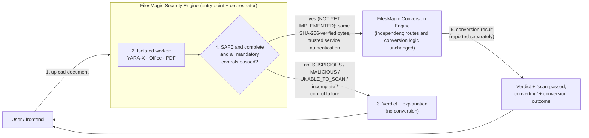

# Intended security-first architecture (proposed, not implemented)

**Status (2026-10-28): intended design only. The invocation from the Security Engine to the
Conversion Engine is not implemented.**

- **Today:** the Security Engine and the FilesMagic Conversion Engine are not integrated. The
  Security Engine runs as a standalone service, on research staging (Render) and in the offline
  research VM. Nothing in this document has been built, deployed or tested end to end.
- **Historical note (superseded):** an earlier analysis of the Conversion Engine
  (`FILESMAGIC_CURRENT_ARCHITECTURE.md` in the website repository) identified a possible
  pre-conversion hook inside its route handler (`engine/app/routes/convert.py`, lines 128-130).
  This design supersedes that option. It requires **no** hook or other change inside the
  Conversion Engine's existing routes.

## Responsibilities

- **The Security Engine is the entry point and the orchestrator.** It scans every upload and
  decides whether to call the Conversion Engine. No separate gateway is needed.
- **The Conversion Engine stays an independent service.** Its conversion logic is unchanged. It
  only receives files that the Security Engine has approved.

## Workflow

1. The frontend uploads the document to the **Security Engine**.
2. The Security Engine runs YARA-X, Office and PDF analysis in its isolated worker.
3. It **always** returns a security verdict with a user-facing explanation.
4. It calls the Conversion Engine **only if all of these hold**:
   - the scan is complete;
   - every mandatory security control passed (`isolation_missing=[]` where strict isolation is
     required);
   - the verdict is `SAFE`.

   It then passes the **same verified bytes** (identified by SHA-256) and tells the user that the
   scan passed and conversion is proceeding.
5. For `SUSPICIOUS`, `MALICIOUS`, `UNABLE_TO_SCAN`, an incomplete scan or a failed security
   control, it does **not** call the Conversion Engine. The user still receives the scan result
   and its explanation.
6. Conversion success or failure is reported **separately** from the security verdict. A failed
   conversion never changes the verdict, and a SAFE verdict never implies the conversion
   succeeded.

## Requirements for a future integration (not yet implemented)

- **The Conversion Engine stays independent and unchanged.** It keeps its existing routes and
  conversion logic. No pre-conversion hook is added inside it.
- **No bypass.** Conversion requests must reach the Conversion Engine only through the Security
  Engine, never directly from the frontend or the internet.
  - This is enforced around the Conversion Engine, not inside it. For example, it could be
    reachable only from the Security Engine on a private network, with a service credential
    required at that boundary.
  - The exact mechanism is an open design decision.
- **Exact-file binding.** The Security Engine forwards the exact bytes it scanned, held in its own
  memory and identified by SHA-256 and size, over the authenticated channel. It never re-fetches
  the file from the client.
  - Whether the receiving side also re-verifies the hash is a later design decision. It would not
    change conversion logic.
- **Separate results.** The response carries the security verdict, the scan explanation and the
  conversion outcome as distinct fields.
- **Fail closed.** If the Conversion Engine is unreachable, the user still gets the verdict, and
  conversion is reported as not performed.

## For Friday's presentation

Present this as the **intended** architecture and the next engineering step, alongside what
exists today:

- the Security Engine with all three scanners, validated in Linux CI and in the offline VM;
- the Conversion Engine, separately, with no integration yet.
